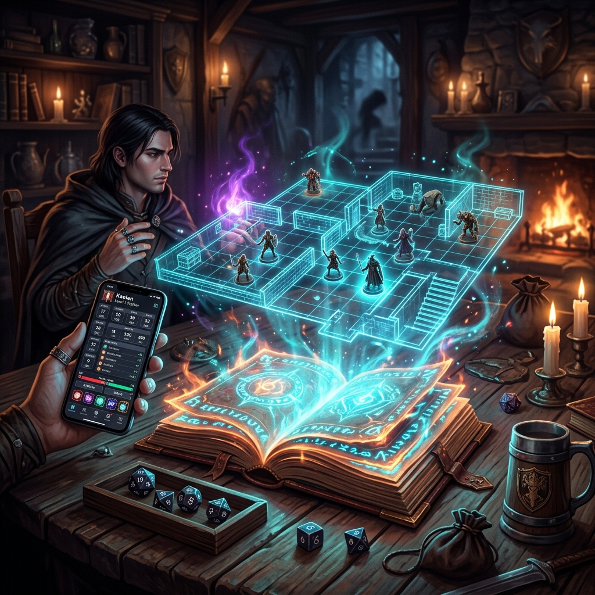

<div align="center">


# Grimoire TTRPG

**L'outil tout-en-un pour les Maîtres du Jeu**
Notes Markdown · Table virtuelle (VTT) · IA locale · HUB mobile pour les joueurs

[](#)
[](https://www.patreon.com/cw/LordMad)

</div>



## 🐉 C'est quoi ?

Grimoire rassemble en **une seule application** tout ce qu'il faut pour préparer et mener une partie de jeu de rôle : vos notes (style Obsidian), une table virtuelle rapide, une IA qui tourne **sur votre PC** (aucun cloud), et une appli mobile pour vos joueurs.

Gratuit, open source, sans compte, pour Windows, Linux et macOS.

## ⬇️ Installation

**Ou téléchargement direct** : rendez-vous sur la page des [Releases](https://github.com/LordMadTrix/grimoire/releases/latest) et choisissez votre version (Windows, Linux ou macOS).

> 💡 Sous Windows, si *SmartScreen* s'affiche : cliquez sur **« Informations complémentaires »** puis **« Exécuter quand même »**.

## ✨ En bref

- 📝 **Éditeur Markdown** pour campagnes, PNJ, lieux, avec liens `[[Note]]` et dés cliquables
- 🗺️ **Table virtuelle (VTT PixiJS v8)** : brouillard de guerre, éclairage dynamique, météo, bulles de dialogue et halos vocaux
- 🎙️ **Studio de Narration & Voix IA HD** : 13 voix neuronales, casting multi-acteurs (pitch/tempo), effets acoustiques DSP (Caverne, Cathédrale, Télépathie)
- 🎬 **Studio Cinéma d'Introduction** (défilement 3D Star Wars, météo cinématique, voix-off IA avec ducking, casting des héros, playlists)
- 🤖 **IA locale (Ollama)** : 100 % privée, hors-ligne, réparties de PNJ instantanées
- 📱 **Joueurs sur smartphone** : un simple QR code, fiches synchronisées, dés, D-Pad VTT et murmures secrets IA
- 🎵 **Mixeur sonore, Soundscape & Balises `[sfx: ...]`** : +800 pistes, bruitages déclenchés dans les notes et compresseur studio
- 🎥 **Tracking de figurines par webcam** (ArUco + bagues 3D)

👇 La liste complète des fonctionnalités est juste en dessous.

---
## ✨ Fonctionnalités Exhaustives du Grimoire

### 1. 📝 Éditeur Markdown Rôliste Ultime (Style Obsidian & Outils MJ)
- **Éditeur Markdown moderne (CodeMirror 6)** : Coloration syntaxique complète, formatage de texte, titres, listes, citations et tableaux.
- **🗂️ Menus Déroulants Thématiques & Boutons Réflexes** : Barre d'outils épurée et intuitive organisée en 5 menus déroulants ergonomiques (`🗛 Titres`, `✍️ Format`, `☰ Listes`, `🎲 Blocs & JdR`, `🔗 Insérer`), épaulée par des boutons réflexes instantanés (`↩️`, `↪️`, `B`, `I`) et un accès immédiat au guide interactif des raccourcis.
- **🖱️ Menu Contextuel au Clic Droit Rôliste** : Clic droit directement dans le texte pour faire surgir un menu contextuel complet sans quitter la souris : rangée de style rapide (**B**, *I*, ==H==, ~~S~~, `</>`), actions directes (`[[Note]]`, Secret MJ, Encadré Note, Case à cocher), sous-menus thématiques et commandes IA contextuelles (Correction stricte, Décrire la scène, Générer un PNJ, Péripétie).
- **⌨️ Guide Interactif des Raccourcis Clavier** : Modale d'aide complète accessible d'un clic sur le bouton `⌨️` récapitulant tous les raccourcis de l'éditeur Markdown, de la navigation et de la table virtuelle.
- **🔍 Recherche & Remplacement Intégrés (<kbd>Ctrl</kbd> + <kbd>F</kbd> et <kbd>Ctrl</kbd> + <kbd>H</kbd>)** : Volet escamotable complet stylisé or et sombre, navigation occurrence suivante/précédente (<kbd>Entrée</kbd> / <kbd>Shift+Entrée</kbd>), surlignage automatique en direct de toutes les correspondances du mot sélectionné (`highlightSelectionMatches`) et bouton loupe dédié.
- **⚡ Saisie Fluide & GitHub Flavored Markdown (GFM)** : Indentation et désindentation directe avec <kbd>Tab</kbd> / <kbd>Shift+Tab</kbd> sans perte de focus, continuation intelligente des listes à puces, numérotées et de tâches (<kbd>Entrée</kbd>), tableaux GFM complets, texte barré `~~` et encapsulation automatique des URLs collées sur une sélection.
- **🌓 3 Modes d'Affichage & Défilement Synchronisé** : Sélecteur instantané dans l'en-tête : ✏️ Éditeur seul (largeur maximale), 🌓 Double vue (Split) avec défilement synchronisé en temps réel sans saccades, et 📖 Mode Lecture seule (rendu HTML centré idéal en cours de partie sur table).
- **💎 Rendu Rôliste & Dés Cliquables dans l'Aperçu** : Callouts multi-lignes fusionnés (`> [!SECRET]`, `> [!LOOT]`, etc.), véritables listes HTML imbriquées `<ul>`/`<ol>`, et formules de dés devenant des badges interactifs cliquables (`🎲 1d20+5`) déclenchant le lancer physique sonore et un toast.
- **📏 Retour à la Ligne Automatique (Line Wrapping)** : Fini le texte qui déborde de l'écran ou les phrases coupées à l'horizontale. Vos notes et récits s'adaptent naturellement à la largeur de votre fenêtre avec césure de mots propre.
- **🪄 Palette Interactive de Prompts IA (<kbd>Ctrl</kbd> + <kbd>J</kbd> ou bouton 🪄 Ollama)** :
  - **Détection automatique et transparente** : Identifie immédiatement le modèle installé dans Ollama (`llama3.2:1b`, `gemma2:2b`, etc.) avec repli intelligent sans plantage ni configuration complexe.
  - **Sélecteur d'Ambiances & Genres en 1-clic** : Ne soyez plus enfermé dans un seul univers ! Choisissez votre tonalité parmi 🧙‍♂️ Fantasy Héroïque, 🌑 Dark Fantasy, ⚔️ Médiéval Réaliste, 🕵️ Enquête & Mystère, 🚀 Sci-Fi & Cyberpunk ou 🛡️ Neutre & Factuel.
  - **Actions Rôlistes Instantanées** :
    - 🔤 **Correction d'orthographe & de style** : Corrige rigoureusement la syntaxe, la grammaire et la ponctuation **sans inventer d'histoire**, avec bouton de remplacement direct dans la note.
    - ✍️ **Continuer l'écriture** : Développe la scène ou la suite naturellement.
    - 🏰 **Décrire un lieu / Décor** : Description sensorielle riche (visuels, acoustique, odeurs, lumière).
    - 👤 **Créer un PNJ** : Fiche synthétique avec identité, secrets inavouables et répliques.
    - ⚔️ **Péripéties & Rebondissements** : Événements imprévus pour relancer le rythme.
    - 🎲 **Table de Butin & Trésors** : Objets insolites, reliques ou indices mystérieux.
    - 📜 **Résumer** : Synthèse claire et structurée en puces.
    - 💬 **Consignes Libres Sur-Mesure** : Champ de commande pour taper n'importe quelle instruction personnalisée.
- **🎲 Inline Dice Roller (Lancer Cliquable)** : Détection temps réel des formules (`1d20+5`, `1d20 + 5`, `2d6 - 1`, `d100`), badge orné d'un dé doré, son procédural de dés (Web Audio) et popup critique avec insertion en 1 clic.
- **🛡️ Styled Callouts Rôlistes** : Rendu en direct des encadrés `[!NOTE]`, `[!SECRET]` (pièges et notes MJ dorées), `[!WARNING]` (dangers mortels), `[!LOOT]` (trésors émeraude) et `[!READALOUD]` (récits pour les joueurs).
- **☑️ Checkboxes Interactives en Direct** : Les listes de quêtes `- [ ]` et `- [x]` sont directement cliquables dans le code source avec sauvegarde instantanée et effet barré automatique.
- **🧘 Mode Zen & Machine à Écrire** : Plein écran épuré sans distraction (<kbd>F11</kbd> / <kbd>Échap</kbd>) et défilement centré Typewriter Scrolling.
- **🪄 Menu IA Contextuel Flottant** : Sélection de texte avec mini-barre d'outils instantanée pour Décrire, dialoguer avec un PNJ, générer des indices sensoriels ou ouvrir le menu complet.
- **🗺️ Passerelle Note ⟷ VTT Map** : Liens `[[map:NomDeScene]]` basculant directement sur la scène de la Table Virtuelle.
- **🎵 Lecteur d'Ambiance Frontmatter** : Champ `ambiance: piste.mp3` déclenchant la bande-son du lieu sur le Soundscape VTT en 1 clic.
- **✍️ Correcteur Hunspell Bilingue & Fantasy** : Correcteur orthographique en tâche de fond (Web Worker) FR & EN avec dictionnaire rôliste et ligatures françaises.
- **↩️ Annuler / Rétablir** : Boutons d'historique `↩️` et `↪️` dans l'en-tête, la barre d'outils et les infobulles.
- **WikiLinks interactifs (`[[Nom de Page]]`)** : Liez instantanément vos PNJ, lieux, factions et objets magiques avec autocomplétion intelligente.
- **Système de Rétroliens (Backlinks)** : Retrouvez en bas de chaque note toutes les autres pages du coffre qui la mentionnent.
- **Moteur de Recherche Instantané (SQLite FTS5)** : Palette de recherche globale (`Ctrl+K` ou `Ctrl+P`) avec recherche textuelle ultra-rapide et extraits en contexte.
- **Vue Graphique 2D Interactive (Graph View)** : Visualisation de l'univers sous forme de toile cosmique avec physique de répulsion des nœuds interconnectés.
- **Timeline & Calendrier Impérial** : Suivi des dates en jeu, avancement du temps (+1h, +1j), gestion des ères et saisons.
- **Gestionnaire de Coffre (Vault Explorer)** : Support de coffres multiples, dossiers, glisser-déposer, favoris et fichiers récents.
- **🤖 Assistant IA Local Intégré (Ollama)** : Assistant d'écriture 100% privé et hors-ligne propulsé par Ollama. Assistant de configuration guidé, détection automatique du démon système (port 11434/11435), téléchargement transparent des modèles (Gemma 2, Llama 3.2) avec jauge en mégaoctets réels et support Linux & Windows sans droit administrateur.

### 2. 🗺️ Virtual TableTop Haute Performance (PixiJS v8 VTT)
- **Moteur Graphique GPU 60+ FPS** : Rendu ultra-fluide des cartes géantes, textures dynamiques et animations sans ralentissement.
- **Éclairage Dynamique & Atmosphères en Temps Réel** : Ambiance Jour ☀️ / Crépuscule 🌅 / Nuit 🌙 / Ténèbres 🌑 / Brume 🌫️ avec filtres d'ambiance colorimétriques, projection d'ombres vectorielles, torches oscillantes et éclairs d'orage synchronisés.
- **Narration Vocale IA Météorologique** : Narration automatique de la météo et de l'environnement par voix neuronales IA (Edge TTS / Web Speech) avec profils d'ambiance (Sombre, Épique, Mystérieux).
- **Dynamic LOS (Line of Sight)** : Les murs et obstacles projettent des ombres portées en temps réel, bloquant physiquement la vision des tokens.
- **Brouillard de Guerre Intelligent (Fog of War)** : Révélation et masquage au pinceau circulaire ou rectangle de sélection, ou vision dynamique individuelle des pions.
- **Gestionnaire de Pions (Tokens) & Visibilité Intelligente** : Import d'images, dimensionnement automatique sur la grille, PV/CA/Stats, conditions (roue radiale ConditionWheel), vision paramétrable, rotation, halos colorés, et contrôle strict de visibilité MJ (masquage par défaut ou révélation automatique selon la ligne de vue / LoS du joueur).
- **Mode Blueprint & Portes Interactives** : Tracez vos murs et configurez des portes interactives que vous pouvez ouvrir/fermer d'un clic pour laisser passer la lumière.
- **Modèles de Sorts & Zones d'Effet (Spell Templates)** : Cercles, cônes orientables et lignes d'effet (Feu 🔥, Glace ❄️, Éclair ⚡, Poison 🧪, Silence 🔇, Divin ✨, Ténèbres 🌑).
- **Zones de Terrain Spéciales** : Délimitation de zones de terrain difficile 🏔️, eau 🌊, feu 🔥, poison 🧪 ou zone sûre ✅.
- **Épingles & Secrets du MJ (Map Pins)** : Épingles visibles uniquement par le MJ ou révélables aux joueurs d'un clic avec descriptions secrètes.
- **Météo Dynamique** : Pluie, Orage (avec éclairs lumineux et tonnerre), Neige, Brouillard, Tempête de sable et Ciel dégagé.
- **💬 Bulles de Dialogue & Halo Vocal VTT (v0.8.18)** : Lorsqu'un PNJ ou l'IA vocale parle, une bulle de bande dessinée stylée surgit au-dessus de son token, accompagnée d'un halo d'ondes sonores bleuté ondulant, synchronisé en temps réel sur l'écran MJ et la Vue Joueurs / TV.
- **🎭 Improvisation Immédiate de PNJ en Jeu** : Clic droit sur n'importe quel token > *« 🎭 Faire parler ce PNJ (IA Vocale) »* : posez une question ou cliquez sur *Spontané* pour qu'Ollama génère une réplique percutante et qu'Edge-TTS la déclenche avec bulle de dialogue sur la carte.
- **Calibration de Grille Rapide** : Outil de tracé 3x3 cases pour adapter instantanément n'importe quelle carte.
- **Mesure de Distances** : Outil règle en temps réel (cases, pieds ou mètres).

### 3. 🎙️ Studio de Narration, Voix Neuronales IA & Immersion DSP (v0.8.18)
- **🎙️ Studio de Narration Dédié** : Console théâtrale multi-acteurs pour répéter, ajuster et lancer des scènes narratives avec alternance instantanée des rôles.
- **👥 Casting de Campagne & Personnages Vocaux Sur-Mesure** : Créez, éditez et sauvegardez vos profils vocaux personnalisés (Orques rocailleux, Elfes éthérés, Nains bourrus, Spectres) avec modulation fine de la **Hauteur / Pitch** (-50 Hz à +50 Hz) et du **Tempo** (0.5x à 1.5x).
- **🏛️ Effets Acoustiques DSP & Lieux en Temps Réel** : Traitement audio spatial Web Audio API (filtre biquad, reverb convolutive et delay) pour immerger la voix dans son environnement :
  - `🎙️ Studio Normal` : Son de studio net et chaleureux.
  - `🦇 Caverne / Donjon` : Réverbération sombre, profonde avec écho lointain.
  - `⛪ Cathédrale / Grand Temple` : Réverbération majestueuse et solennelle de grande nef.
  - `🧠 Télépathie Mentale` : Passe-bande éthéré et résonance intracrânienne.
  - `👻 Écho Spectral` : Traînée fantomatique spectrale pour revenants et apparitions.
- **🔊 Balises Sonores Synchronisées (`[sfx: ...]`)** : Insérez `[sfx: sword]`, `[sfx: thunder]`, `[sfx: magic]`, `[sfx: monster]` ou `[cave]` directement dans vos notes Markdown. Les bruitages se déclenchent automatiquement au fil de la lecture vocale sans être prononcés à voix haute.
- **Liseuse PDF Vectorielle HD** : Affichage fluide avec zoom, navigation par page, recherche textuelle et sommaire interactif.
- **Analyseur Multi-Colonnes & Désentrelacement Spatial** : Reconstitution automatique de l'ordre de lecture logique sur les livres en 1, 2 ou 3 colonnes (type AD&D, Dragonlance, D&D 5e, Pathfinder) avec réparation des césures de mots et élimination des interférences de lignes.
- **Lecteur par Boîte de Sélection Interactive (Drag-to-Select)** : Encadrez n'importe quel paragraphe ou bloc de texte à la souris pour lancer sa lecture vocale instantanée ou l'extraire.
- **Synthèse Vocale Neuronale IA (Microsoft Azure / Edge TTS)** : 13 voix ultra-réalistes et expressives (Narrateur Henri, Denise, Gérard, Éloïse, Rémy, etc.) avec vitesse et tonalité ajustables.
- **Mode Multi-Voix PNJ Automatique** : Détection automatique des dialogues entre guillemets et alternance de voix (Narrateur, PNJ masculins, féminins, monstres).
- **Auto-Ducking Musical** : Baisse automatique et douce du volume sonore ambiant pendant la lecture vocale.
- **Cartes Narratives Découpées (Onglet Chapitres)** : Découpe intelligente de la page en cartes de scènes (Descriptions 🌲, Dialogues 💬, Combats ⚔️, Évènements 📜) avec temps de lecture et bouton de lecture en 1 clic.
- **Détection & Lancer de Dés direct (« Click-to-Roll »)** : Détection automatique des formules (`1d20+5`, `2d6`, `d100`) dans le texte avec lancer instantané et bruitage physique.
- **Découpeur de Carte VTT (1 Clic)** : Glissez la souris sur un plan du PDF pour le projeter instantanément comme carte de bataille sur la Table Virtuelle.
- **Handouts & Révélations Joueurs** : Projetez en 1 clic des illustrations, parchemins et indices sur les écrans et smartphones des joueurs.
- **OCR Intégré (Tesseract)** : Transcription et lecture vocale des vieux livres et suppléments scannés.
- **Résumé de Scène par IA Locale (Ollama)** : Extraction en 1 clic des Objectifs 🎯, Dangers ⚠️, Secrets 💡 et Trésors 💎.

### 4. 👥 Multi-Écrans & HUB Mobile Joueur PWA
- **Vue Joueur Dédiée (Player View)** : Affichage sur 2ème écran / TV / Vidéoprojecteur sans aucune interface MJ, avec synchronisation du brouillard de guerre, de l'éclairage, des bulles de dialogue et mode Écran Noir (Blackout).
- **🤫 Murmures Secrets IA sur Smartphone (v0.8.18)** : Le MJ peut chuchoter un secret depuis le volet Joueurs Express directement dans le casque ou l'écran du joueur ciblé avec synthèse vocale neuronale privée.
- **Serveur Web Mobile Intégré (Axum + WebSockets)** : Connexion instantanée des joueurs par simple scan de QR Code (zéro installation requise).
- **Mode PWA & Screen Wake Lock** : L'écran des smartphones reste allumé pendant toute la session sans mise en veille.
- **🕹️ D-Pad Tactile VTT** : Les joueurs déplacent leur propre pion sur la grille de la table virtuelle directement depuis leur mobile.
- **Fiches Joueur & Suivi des PV** : Fiole de sang liquide interactive, suivi des stats, compétences et inventaire.
- **Murmures & Messagerie Secrète** : Discussions privées chiffrées entre le MJ et un joueur spécifique.
- **Sketchpad & Sons Joueurs** : Dessins tactiques collaboratifs et bruitages déclenchables par les joueurs.
- **💾 Persistance Définitive des Comptes & Fiches Joueurs (`.grimoire/player_accounts.json`)** : Création de compte autonome avec mot de passe par chaque joueur, sauvegarde permanente et restauration automatique de la fiche et de l'avancement (PV, PV Max, XP, caractéristiques, destins, corruption, blessures critiques, inventaire).
- **🛠️ Gestion & Édition Complète par le MJ** : Contrôle total du MJ sur les comptes (renommer, réinitialiser mot de passe, modifier stats, PV, XP) et suppression de compte avec synchronisation WebSocket instantanée (`push_character`) sur le smartphone du joueur.
- **🪟 Volet Flottant Déplaçable MJ (HUD Express Joueurs)** : Fenêtre flottante déplaçable à la souris sur la Table Virtuelle avec :
  - **Drag & Drop sur la carte** : Glissez l'avatar du joueur (connecté ou hors-ligne) pour poser ou déplacer immédiatement son token sur la battlemap.
  - **Santé & Conditions Express** : Boutons rapides `[-5]`, `[-1]`, `[+1]`, `[+5]`, pastilles de conditions WFRP et demandes de tests de dés directes.
  - **Édition Express 1-Clic (`✏️`)** : Tiroir d'édition rapide pour ajuster PV, stats ou mot de passe en cours de combat sans quitter la scène.
- **📱 Carnet Nomade du MJ (`/mj`) & Bouclier Anti-Perte (v0.6.9)** :
  - **Application Web Mobile Ultra-Rapide** : Accessible directement sur smartphone via `http://[IP]:7438/mj` avec dictée vocale, modèles JDR express, générateur aléatoire hors-ligne et retours haptiques.
  - **Protection Anti-Effacement** : Refus systématique des payloads vides sur mobile et sur le serveur PC pour empêcher tout effacement accidentel.
  - **Sauvegardes Préventives Automatiques** : Historique de sauvegarde horodaté (`.grimoire_backups/mobile_sync/`) créé sur PC avant chaque écrasement.
  - **Détection des Conflits Horodatés** : Si le fichier PC est plus récent, il n'est jamais écrasé et la note mobile est sauvegardée dans une note de conflit dédiée (`_conflit_mobile_`).
  - **Protection Mobile Dédiée** : Proposition de copie séparée `[Titre] (PC)` lors du téléchargement d'une note déjà modifiée sur le smartphone.

### 5. 🧙‍♂️ Outils du Maître du Jeu & Générateurs
- **🎙️ Annonceur Vocal de Combat Épique (v0.8.18)** : Dans le Tracker d'Initiative, activez le bouton microphone 🎙️ pour que l'IA vocale annonce automatiquement chaque tour de jeu à haute voix (*« C'est au tour de Madtrix ! »*, *« Tour de Garde Orque, préparez-vous ! »*), avec retentissement de gong dramatique et avertissements de round immersifs.
- **Écran du MJ Tactique (Dashboard)** : Vue d'ensemble de tous les héros, PV, CA et modificateurs.
- **Tracker d'Initiative & Combat** : Gestion des tours, décompte des rounds et états de combat.
- **Générateur de Donjons Procéduraux ⟷ VTT Sync** : Création automatique de plans de donjons complets (pièces, couloirs, salles de boss, autels, cryptes, dalles piégées) avec projection instantanée des murs physiques (LOS) et des sources lumineuses sur la Table Virtuelle.
- **Générateurs Rapides** : PNJ avec personnalités, Butins & Trésors, Rencontres aléatoires, Salles de donjon, Météo (7 jours).
- **Règles Spécifiques WFRP & Dark Fantasy** : Blessures Critiques 🩸, Mutations du Chaos 🌑, Calculateur de Combat Opposé (SL Net).
- **Marchands Procéduraux** : Échoppes avec inventaires et prix calculés selon la rareté.
- **Système de Rumeurs & Murmures de Taverne**.
- **Lanceur de Dés 3D Physique** : Avec calcul des modificateurs et sons réels.
- **Journal de Quêtes & Arbre de Campagne** : Suivi des quêtes (Principales, Secondaires, Secrets) avec diffusion du compte-rendu aux joueurs.
- **Export & Sauvegarde de Campagne (`.grimoire`)**.

### 6. 🎵 Mixeur Sonore, Playlists & Studio Cinéma d'Introduction
- **🎬 Studio Cinéma d'Introduction de Session (Écran Joueur & 2e Écran)** : Projetez une ouverture de soirée digne d'une superproduction cinématographique :
  - **Défilement spatial 3D (Crawl)** : Texte d'ambiance en perspective montante avec estompage doux à la manière des prologues spatiaux légendaires.
  - **Voix-Off IA & Auto-Ducking** : Narration vocale expressive du prologue avec baisse automatique instantanée du volume musical à 25% et remontée fluide en fin de réplique.
  - **Générique des Héros (« Casting de la table »)** : Défilé des PJ avec avatars ronds dorés, noms et classes projetés en bas de l'écran.
  - **Accroche Théâtrale par IA Locale (Ollama)** : Génération instantanée d'un résumé dramatique en 2-3 phrases immersives selon le titre de votre séance.
  - **Compte à Rebours Synchrone** : Minuteur d'attente stylisé (1, 2, 3 ou 5 min) pour faire monter la tension pendant l'installation des joueurs.
  - **5 Effets Météo Cinématiques en Surimpression** : Pluie ruisselante, chute de neige ralentie, braises rougeoyantes et tempête violente zébrée d'éclairs lumineux réalistes.
  - **Bibliothèque de 5 Thèmes Audio Intégrés** : Épopée & Gloire, Mystère & Crypte, Auberge Chaleureuse, Nuit de Tempête, Rivages & Traversée prêts à jouer sans fichier externe.
  - **Chaîne de Normalisation Studio (DynamicsCompressor)** : Traitement Web Audio de studio (compresseur de dynamique + gain automatique) pour éliminer les disparités de niveau sonore des fichiers MP3.
- **🎵 Lecteur de Playlists Personnalisées** : Importez vos propres MP3/OGG/WAV, organisez vos morceaux en listes de lecture thématiques (Combat, Exploration, Taverne), gérez les transitions et profitez d'une commande de coupure sonore absolue (Stop Global) éteignant instantanément musiques et synthétiseurs procéduraux (vent, tempête) sans résidu sonore.
- **Mixeur d'Ambiances Multi-Pistes** : Superposition continue d'environnements sonores (Pluie, Forêt, Taverne, Donjon, Tempête, Feu).
- **Double Lecteur Musical (Piste 1 & Piste 2)** : Avec contrôles de volume indépendants et fondus sonores enchaînés.
- **SoundBoard d'Effets Spéciaux (SFX)** : Déclenchement instantané d'effets (Cris, Épées, Magie, Monstres, Tonnerre, Portes).
- **Zones Audio Spatiales (2.5D)** : La musique d'ambiance s'adapte automatiquement selon l'emplacement du groupe sur la carte.
- **Auto-Ducking Musical** : Atténuation automatique du fond sonore lors des prises de parole vocales ou de la narration IA.

### 7. 🌌 Bibliothèque Céleste & Audio Grimoire (Addon Store)
- **Catalogue Audio Studio Complet (+800 Pistes)** : Musiques orchestrales et bruitages d'ambiance classés par thèmes (⚔️ Combat, 🏰 Donjons & Horreur, 🍺 Villes & Tavernes, 🌲 Nature, 🚀 Sci-Fi, 🔊 Bruitages & SFX).
- **Mini-Lecteur Audio Streaming Intégré** : Pré-écoute instantanée dans le store avec barre de recherche temporelle (Seekbar), réglage de volume et lecture en boucle.
- **Bouton `🎵 Diffuser vers VTT`** : Projetez en 1 clic n'importe quelle piste du catalogue vers le canal d'ambiance actif de la Table Virtuelle.
- **Installation 1-Clic dans le Coffre** : Téléchargement direct des musiques dans `assets/audio/` de votre campagne active.
- **Packs d'Aventures & Assets** : Téléchargement et installation en 1 clic de packs officiels et communautaires : Campagnes, Livres PDF, Bestiaires, Banques de textures et tampons HD.
- **Contributions Communautaires Encadrées** : Soumettez votre pack via le [template d'issue dédié](https://github.com/LordMadTrix/grimoire/issues/new?template=addon-submission.yml) — un validateur CI vérifie liens, tailles et cohérence avant publication (voir le [guide contributeur](docs/ADDONS-CONTRIBUTING.md)).
- **Système de Cache Intelligent** : Chargement instantané à 0 ms, catalogue Drive chargé à la demande (manifeste de 400 o + fragments par dossier) et détection automatique des nouveautés.

### 8. 🌿 Guide de l'Herboriste & Lapidaire (Module Intégré — 20 Ateliers & Simulateurs)
Un compendium complet d'herboristerie, d'alchimie, de lapidaire et de minéralogie directement accessible depuis la barre d'outils VTT (`🌿 Guide de l'Herboriste`) :
- **📖 Grimoire Complet** : Livre à pages navigable (règles de récolte, herbier illustré, recettes) prêt à consulter en séance.
- **🌿 Herbier & Index** : 97 plantes détaillées (biomes, rareté, DD de récolte et d'alchimie, illustrations botaniques SVG) avec filtres, tri, favoris ❤️, ajout de plantes *homebrew* persistées et **générateur de Handouts Joueurs parcheminés**.
- **⚗️ Atelier Alchimie & Labo Avancé** : Recettes de potions/onguents/teintures, creuset avec jet de concoction d20, moteur de synergies plantes + minéraux et table de potions aléatoires.
- **💀 Compendium des Poisons & Distillerie** : Vecteurs, conditions, antidotes liés aux plantes, règles de détection, marché noir et **distillerie de venins de créatures**.
- **🍄 Fongarium Mystique & Mycologie Souterraine** : 8 espèces fongiques bioluminescentes et toxiques, chambre de culture sur substrat et tests de résistance aux spores.
- **🧭 Simulateur de Cueillette & 📜 Guide du Récolteur** : Jets de récolte avec modificateurs (météo, lune, durée, équipement), tables de rareté d100 par biome, rencontres de fourragement d20 et sosies toxiques.
- **🌱 Serre Botanique Mystique** : 4 bacs de culture interactifs, arrosage, engrais alchimiques, progression au repos long et chaudron d'hybridation.
- **🧺 Séchage & Conservation d'Herbes** : 4 procédés (séchoir suspendu, teinture-mère, salaison, miel sauvage), gestion des péremptions et bonus d'efficacité.
- **🎒 Sacoche d'Apothicaire & Grille Tactique** : Inventaire de 12 compartiments pour fioles et poudres, jauge de fragilité et simulateur de casse aux chutes et coups critiques en donjon.
- **📜 Générateur de Quêtes & Rumeurs de Filons** : Accroches de tavernes procédurales, gardiens de bestiaire et conditions spéciales de récolte.
- **🐺 Bestiaire Récoltable** : 42 créatures avec composants à prélever (venin, organes, écailles, spores…) et simulateur de jet de récolte.
- **⛏️ Minéraux & 🔨 Forge Naine** : Catalogue de minerais magiques, simulateur d'extraction, recettes de forge (trempe, sertissage de gemmes, composants de monstres).
- **💎 Lapidaire de Fangh & Prospection Alluviale** : 32 gemmes avec planches gemmologiques, calculateur de prix en Goltors (Naheulbeuk-compatible), **Atelier de Taille & Facettage** (meules, DD de Mohs) et **simulateur de prospection alluviale & casse de géodes**.
- **💍 Établi de Joaillerie Runique** : Enchâssez vos gemmes taillées sur 5 supports forgés (anneau, torque, dague...) avec 5 métaux nobles. Rendu SVG dynamique et export de fiches d'objets magiques.
- **🌙 Almanach Astral & Marées Telluriques** : Disque lunaire interactif (8 phases), constellations de Fangh, marées de sève et influences magiques en temps réel.
- **⚖️ Bourse Régionale & Négociation au Comptoir** : Indices des cours des 5 cités de Fangh et mini-jeu de marchandage au d20 face aux marchands PNJ.
- **🎲 Table des Fiascos Comiques & Prodiges Inattendus** : 20 fiascos déjantés et 20 prodiges miraculeux au d100 pour pimenter les jets critiques de craft.
- **📡 Passerelle VTT, Écran Joueur & Compagnons Mobiles (Nouveauté)** :
  - **👁️ Révélation Cinématique sur Écran Joueur (2e écran / Rétroprojecteur)** : Projetez des parchemins enluminés plein écran avec sceau de cire officiel, illustrations botaniques/gemmologiques et notes secrètes du MJ.
  - **🔍 Mode Mystère & Dévoilement Participatif** : Projetez un spécimen non-identifié. Les joueurs lancent un test d'Herboristerie sur leur smartphone pour débloquer progressivement les indices (famille, vertus) directement sur le rétroprojecteur avec animation d'encre ancienne !
  - **🎒 Sacoche Botanique Mobile & Cadeaux du MJ** : Le MJ peut transférer des plantes, potions ou gemmes directement dans l'inventaire mobile des PJ connectés en Wi-Fi local.
  - **💀 HUD de Survie & Antidotes en Direct** : Le MJ peut infliger un empoisonnement en direct ; le mobile du joueur passe en alerte rouge avec vibrations, et un bouton d'urgence permet de consommer automatiquement l'antidote approprié depuis la sacoche.
  - **⚖️ Marchand Ambulant Connecté** : Le MJ ouvre son étal d'apothicaire en 1 clic pour diffuser le catalogue sur les téléphones des joueurs pour achat et vente immédiate.
  - **⛏️ Radar Minier & Enduits d'Armes au Combat** : Détection de filons par vibration mobile lors de l'exploration, et possibilité pour les guerriers/roublards d'enduire leurs armes de venins (+1d6 poison sur 3 frappes).
  - **🏷️ Générateur d'Étiquettes d'Apothicaire & Grand Folio** : Impression de véritables étiquettes de fioles d'officine vintage (posologie, lot, avertissement Naheulbeuk) prêtes à découper ou exporter.
- **🎧 Ambiances Procédurales Web Audio** : Soundscapes sonores générés en temps réel sans aucun fichier audio externe (Forêt, Torrent, Mine, Alchimie).
- **🖨️ Export PDF A4 & Handouts** : Livret de poche ou grand grimoire imprimable, profil joueur et sélection de favoris.
- **🔍 Recherche Globale** : Plantes, créatures, gemmes et minéraux accessibles instantanément depuis une barre unique.

### 9. 🎥 Tracking Optique Table & Figurines 3D (Webcam & Rétroprojecteur)
Transformez n'importe quelle table avec vidéoprojecteur en véritable table de jeu augmentée :
- **Détection des Figurines Physiques par Webcam** : Suivi optique en temps réel des figurines sur la table via des marqueurs fiduciaires ArUco 4×4 discrets.
- **Fichiers 3D (STL) Inclus & Téléchargeables** :
  - **Bagues adaptatrices clipsables** (25.4 mm / 1 pouce, 28.5 mm Wargame, 32.5 mm Infanterie lourde, 50.8 mm Grandes créatures). Zéro colle sur vos figurines peintes : la figurine s'encliquette par friction dans la bague amovible.
  - **Équerres de calibration d'angle L-Bracket** : À poser aux 4 coins de la table pour calibrer la caméra en quelques secondes.
- **Planche d'Étiquettes A4 Vectorielle Prête à Imprimer** : 24 marqueurs ArUco distincts (PJ, PNJ, Sbires, Boss) à imprimer à l'échelle 100% avec ouverture automatique dans votre navigateur système (Firefox/Chrome/Edge) ou export HTML.
- **Révélation Automatique du Brouillard de Guerre** : Déplacez votre figurine physique sur la table : le brouillard de guerre s'ouvre dynamiquement sous vos yeux et la torche éclaire le donjon en direct.
- **Filtrage Anti-Tremblement & Homographie Projective** : Algorithme EMA (Exponential Moving Average) et deadband de précision pour un mouvement fluide sans aucun jitter de caméra.
- **Activation en 1 Clic dans les Réglages** : Activez ou coupez la caméra à tout moment dans `⚙️ Réglages > Tracking Optique`.

---

<h2 id="tracking-optique">🚀 Guide Pas-à-Pas : Tracking Optique & Impression 3D</h2>

Pour installer votre table de jeu physique augmentée en 4 étapes simples :

```
       [ Rétroprojecteur ]            [ Webcam USB (1080p) ]
               \                                /
                \                              /
                 ▼                            ▼
        ┌───────────────────────────────────────────────┐
        │  Table de jeu physique (Carte projetée)       │
        │                                               │
        │        🧙 Figurines montées sur bagues 3D     │
        │           avec étiquettes ArUco               │
        └───────────────────────────────────────────────┘
```

1. **Étape 1 : Imprimer les socles en 3D** :
   - Ouvrez `⚙️ Réglages` dans Grimoire et descendez à **Tracking Optique**.
   - Cliquez sur `⬇️ STL` (ou `⬇️ Télécharger tout le pack STL`) pour obtenir vos fichiers `.stl` (25 mm, 28.5 mm, 32.5 mm, 50.8 mm).
   - Tranchez en PLA avec 20% de remplissage et 0.20 mm de couche (aucun support requis).
   - Clipsez vos figurines dans les bagues : elles restent 100% amovibles et intactes !
2. **Étape 2 : Imprimer et coller les étiquettes ArUco** :
   - Cliquez sur `🖨️ Imprimer la planche (A4)` puis sur `🌐 Ouvrir dans le navigateur`.
   - Imprimez la planche à l'échelle **100% (taille réelle)** sur papier standard ou vinyle autocollant.
   - Découpez les carrés et collez-les dans la gorge supérieure de chaque bague.
3. **Étape 3 : Fixer la webcam et calibrer** :
   - Placez une webcam 1080p au plafond ou sur le rétroprojecteur, orientée vers le bas.
   - Activez l'interrupteur dans les réglages et sélectionnez votre webcam.
   - Cliquez sur `🎯 Calibrer 4 coins` et cliquez successivement sur les 4 coins de la zone projetée.
4. **Étape 4 : Associer vos figurines et jouer !** :
   - Sur la carte du Grimoire, ouvrez les paramètres du pion et renseignez son `Marqueur physique 3D (ArUco ID)`.
   - Déplacez votre figurine sur la table : le pion virtuel et la lumière dynamique s'animent en direct !

---

## 🌟 Nouveautés v0.8.20 — Table du MJ trouvée par son nom, mises à jour de l'APK & correctifs

- **📱 Compagnon : la table trouvée par son nom** : le bouton `🔍 Trouver` balaie tout le Wi-Fi et affiche les tables disponibles par leur nom (*« Ma Campagne (MADPC) »*) au lieu d'une adresse IP. Au premier lancement, la recherche démarre toute seule ; si l'IP du PC change, l'appli retrouve la table par son nom et se reconnecte.
- **⬇️ Mises à jour de l'APK** : l'appli Android signale qu'une nouvelle version est publiée sur GitHub et propose de la télécharger. Le numéro de version de l'APK suit désormais celui de Grimoire.
- **🔊⚔️ Liaison smartphone → MJ** : les sons (Cor, Choc, Sort) et les actions de combat (Attaque, Esquive, Charge, Désengagement) envoyés depuis le téléphone arrivent enfin chez le MJ (notification + log de combat).
- **🗺️ Interface** : écran d'accueil quand aucune carte n'est sur la table, barre d'outils VTT qui ne déborde plus sur les écrans moyens.
- **🔒 Sécurité** : le hub mobile vérifie l'hôte exact des origines autorisées (les domaines déguisés comme `localhost.exemple.com` sont refusés).

---

## 🌟 Nouveautés v0.8.19 — Dérouleur de Scènes MJ, FX de Projectiles, Voix Divines/Démoniaques, Log de Combat & Auto-Scan Mobile

- **🎬 Dérouleur de Scènes du MJ (Scene Runner)** : Bandeau supérieur escamotable permettant de préparer à l'avance les scènes clés de la séance (*1. Auberge, 2. Embuscade en Forêt, 3. Assaut sous l'Orage, 4. Donjon des Oubliés*). En un seul clic, Grimoire applique simultanément la météo, l'éclairage d'ambiance, la carte VTT, l'acoustique sonore et les notes du MJ, avec navigation fluide `◀ Précédent` / `Suivant ▶`.
- **⚡ Effets Visuels de Projectiles & Bruits de Pas VTT** : 
  - **Projectiles Animés PixiJS v8** : Clic droit sur n'importe quel token > *« ⚡ Tirer Projectile / Sort »* (`🏹 Flèche`, `🔥 Feu`, `⚡ Éclair`, `🔮 Magie`) pour projeter un éclair ou une flèche avec traînée particulaire lumineuse, onde d'impact et synchronisation instantanée sur l'écran joueur / TV.
  - **Bruits de Pas Procéduraux** : Déplacement d'un pion générant un bruit de pas adapté au terrain foulé (pierre, parquet de bois, éclaboussure d'eau, feuillage).
- **🎙️ Studio de Narration : Effets DSP Voix Divine & Démoniaque** : 
  - `✨ Voix Divine` : Chorus éthéré et scintillement harmonique céleste pour dieux, séraphins et entités supérieures.
  - `👹 Voix Démoniaque` : Pitch abyssal sub-harmonique, distorsion sombre et résonance d'outre-tombe pour seigneurs du chaos et démons.
  - Balises de script Markdown directes : `[divine]` et `[demonic]` pour basculer la voix au fil de la lecture.
- **📜 Log de Combat Chronologique & Résumé de Bataille IA (Ollama)** :
  - Historique chronologique complet des rounds (attaques, dégâts reçus, soins appliqués, tours de jeu et ennemis terrassés).
  - Bouton **« 🪄 Résumé de Bataille IA »** : Ollama rédige en quelques secondes un compte-rendu dramatique et viscéral en deux paragraphes prêt à être archivé ou lu aux joueurs.
- **📱 Compagnon Mobile : Auto-Scan Wi-Fi & Mode HUD de Table Always-On** :
  - **Auto-Scan Wi-Fi en 1 clic** : Balayage automatique du réseau local sur le smartphone ou l'APK Android pour détecter automatiquement l'ordinateur du MJ sans avoir à saisir l'adresse IP manuellement.
  - **Mode HUD de Table Always-On** : Interface épurée haute lisibilité (PV géants, boutons de dégâts/soins rapides, état du tour de combat) conçue pour poser le smartphone au centre de la table de jeu.
- **🛡️ Correctif d'Affichage des Pions VTT** : Élimination définitive des carrés noirs sur les avatars joueurs/PNJ grâce à la synchronisation explicite des textures WebGL et un masque circulaire PixiJS garanti, avec fallback élégant sur l'initiale du héros en cas de profil sans illustration.

---

## 🌟 Nouveautés v0.8.17 — Compagnon Joueur Autonome Offline-First & App Dédiée

- **💾 Fiche Joueur Permanente & Offline-First (IndexedDB)** : Chaque joueur conserve sa fiche directement sur son appareil. Même si le PC du MJ redémarre ou que le navigateur est fermé, aucune donnée n'est perdue.
- **📱 Application Dédiée Android (APK)** : Fichier `Grimoire_Compagnon_V0.8.17.apk` prêt à installer sur tout smartphone ou tablette Android, sans passer par le store, avec permissions caméra et expérience plein écran.
- **🍎 Application Dédiée Apple iPhone & iPad (PWA Standalone)** : Installation en 1 clic via Safari (*« Sur l'écran d'accueil »*), icône dorée, Service Worker pour fonctionnement hors-ligne total et affichage immersif sans barre d'adresse.
- **📷 Scanner QR Code par Caméra Intégré** : Bouton caméra sur l'écran d'accueil permettant de scanner instantanément le QR Code du MJ sans jamais avoir à taper d'adresse IP.
- **💾 Export & Import JSON en 1 Clic** : Sauvegarde de secours téléchargeable en fichier `.json` et restauration immédiate sur un nouvel appareil.
- **⚪/🟢 Synchronisation Automatique avec le MJ** : Dès l'arrivée à la table, l'application se connecte au Wi-Fi du MJ, synchronise l'état et réconcilie les modifications en temps réel.

---

## 🌟 Nouveautés v0.8.16 — Compagnon Mobile & Tablette Réinventé, D-Pad VTT & Studio Cinéma

- **📱 Interface Tablette Complète (Split Layout Paysage)** : Disposition responsive en double colonne haute résolution sur grand écran (iPad, Android, surface tactile).
  - *🧙 Perso* : Avatar, identité et fiole de santé avec boutons tactiles instantanés (`-5`, `-1`, `+1`, `+5`) à gauche ; carrière et compétences interactives à droite.
  - *⚔️ Combat Unifié* : D-Pad tactile de déplacement en direct du pion sur la table VTT, actions rapides (Attaque, Esquive/Parade, Charge, Désengagement) et gestion des points d'armure par localisation.
  - *🎒 Équipement & Magie* : Points vitaux (Destin, Magie, Folie, XP) et sortilèges à gauche ; inventaire, dotations et origines sociales à droite.
  - *🎲 Dés Tactiles* : Grille panoramique 7 colonnes (d4 à d100), bouton Fureur d'Ulric (d10 explosif), historique et tests de compétences en 4 colonnes.
  - *🗺️ Carte Tactique Agrandie* : Vue de jeu panoramique à 480px de haut pour suivre l'exploration de l'équipe sans manipulation.
- **🛡️ Connexion Fiabilisée & Navigation Privée** : Écran de connexion Glassmorphism doré avec blason, tolérance aux minuscules/majuscules et compatibilité totale avec la navigation privée (Safari / Chrome).
- **🎬 Studio Cinéma d'Introduction & Playlists Audio** : Défilement spatial 3D Star Wars / Prologue, météo cinématique en surimpression sur l'affiche, voix-off IA avec ducking audio automatique, casting des héros et normalisation sonore dynamique studio.

---

## 🌟 Nouveautés v0.8.14 — Immersion VTT, Tiroir Notes & Mobile Fiabilisé

- **📜 Tiroir Flottant de Notes MJ en Jeu (<kbd>N</kbd>)** : Consultez vos fiches de lore, bestiaires et secrets de donjon directement par-dessus la Table Virtuelle sans quitter votre scène. Recherche instantanée et bouton **« 🪙 Poser en Pion VTT »** pour placer instantanément un monstre ou PNJ sur la carte avec ses caractéristiques.
- **🔊 Diffusion SFX Multi-Écrans en Direct** : Les bruitages joués par le MJ (Soundboard, Inline Dice Roller, sorts) retentissent maintenant en temps réel sur la **Vue Joueurs** (2e écran, TV de salon ou vidéoprojecteur) via Web Audio synchronisé.
- **🧊 Gabarit de Sort « Cube » & Raccourcis VTT** : Rendu dynamique PixiJS v8 des sorts en zone cubique/rectangulaire. Nouveaux raccourcis réflexes en session : <kbd>W</kbd> (Météo instantanée), <kbd>M</kbd> (Mesure / Règle), <kbd>F</kbd> (Brouillard de guerre), <kbd>N</kbd> (Notes MJ).
- **🧙‍♂️ PNJ Express Enrichi par IA Locale** : Générateur de PNJ ultra-rapide avec attitudes, secrets inavouables et bouton **« 🪄 Détails IA (Ollama) »** pour générer des répliques et détails uniques injectés dans le token.
- **🛡️ Éditeur de Tokens 100% Résilient (Anti Canvas Tainted)** : Fin définitive des erreurs de canvas souillé lors de l'exportation ou de la sauvegarde de tokens avec frises dorées et bordures personnalisées.
- **📱 Hub Mobile GSM Fiabilisé & Sécurisé** : Sélecteur de héros au démarrage de la PWA mobile, connexion insensible à la casse, réinitialisation de mot de passe en 1 clic par le MJ et synchronisation instantanée des PV et statuts.

---

## ⚡ Nouveautés v0.8.4 — Vue Joueurs ultra-fluide (60 FPS)

- **🎮 De ~1 FPS à 60 FPS** : la fenêtre *Vue Joueurs* était plafonnée à 1–7 FPS sur les machines NVIDIA sous Wayland (copie inter-GPU imposée par le forcage PRIME à chaque image). Ce forcage n'est désormais activé qu'en session X11 native : **56–71 FPS mesurés en pleine synchronisation MJ**, 62 FPS au repos.
- **🖼️ Compositing plein écran allégé** : animation `star-pulse`, 5 `backdrop-filter`, vignette/scanlines CSS et ombres plein écran retirés — la vignette est désormais rendue par PixiJS dans le canvas.
- **🔥 Rendu par signature** : les passes Brouillard de Guerre et Éclairage ne se relancent que si leur contenu a réellement changé ; les émissions de synchro MJ identiques ne consomment plus rien.
- **🚀 Accélération matérielle vérifiée** : renderer DMABUF de WebKitGTK réactivé (20 → 47 FPS sur contrôle plein écran), aucun rendu logiciel, CPU au repos ~1 %.
- **🪟 Ouverture de fenêtre** : show → focus → fullscreen (fini la fenêtre joueurs cachée derrière le jeu).

> 💡 La fenêtre reste cadencée par WebKitGTK (~60 FPS max, limite du moteur) : la puissance de la carte n'est plus le facteur limitant.

---

## 🧠 Intelligence Artificielle Locale — Nouveautés v0.7.5

- **🧠 Mémoire de Campagne des PNJ** : Les PNJ récurrents se souviennent des joueurs ! Chaque interaction est résumée localement (`.grimoire/npc-memory.json`), et l'IA réinjecte ce passé dans ses répliques : dettes, griefs, secrets partagés… Vos joueurs seront pris de court.
- **📖 Chronique de Séance Automatique** : En fin de partie, Grimoire rédige le récit de la séance à partir des faits réels de la table (timeline, calendrier, combats, personnages) — éditable, exportable en HTML/PDF. Zéro comptabilité, que du récit.
- **🎙️ Transcription de Table 100% Locale (whisper.cpp)** : Enregistrez votre séance, Grimoire la transcrit en texte hors-ligne via un modèle whisper embarqué. Aucun cloud, même philosophie qu'Ollama.

---

## 🎨 FANTASY MAP EDITOR (Éditeur de Cartes Dédié)

- **🏔️ Moteur de Terrain & Sculpture** :
  - Outil Sculpture : Pinceaux d'ajout et de retrait de terre pour sculpter îles, archipels, côtes rugueuses et mers profondes.
  - Générateur de Continents Procédural : Création instantanée de masses continentales réalistes basées sur du bruit fractal de Perlin.
  - Outil Peinture : Application fluide de textures de sol (Herbe, Roche, Sable, Neige, Marais, Donjon, Pavés, Eau profonde).
- **🏰 Bibliothèque Massive de Tampons (Stamps)** :
  - Des milliers d'assets HD : Nature (Arbres, Montagnes), Bâtiments (Châteaux, Villes, Villages), Donjons (Murs, Mobilier, Trésors), Maritime (Bateaux, Monstres marins), Cartographie (Boussoles, Bannières).
  - Manipulation PAO : Rotation libre 360°, mise à l'échelle, duplication, verrouillage, ordre des calques, teinte et transparence.
  - Scatter Tool : Posez des forêts ou massifs montagneux vivants d'un seul coup de pinceau sans répétition.
  - Magnétisme intelligent sur la grille (Grid Snap).
- **✏️ Tracé Vectoriel, Formes & Textes** :
  - Tracé de routes, sentiers, rivières et frontières avec styles et épaisseurs personnalisables.
  - Formes géométriques (Rectangles, Polygones, Cercles).
  - Textes calligraphiques avec polices de fantasy (*Cinzel, MedievalSharp*), ombres et bordures.
- **📜 Grilles & Ambiance Visuelle** :
  - Grille Carrée & Hexagonale (Pointy-topped & Flat-topped) avec taille et couleur ajustables.
  - Filtres d'ambiance : Parchemin Ancien, Sépia Épique, Nuit Mystique, Haut Contraste, Vignetage sombre et Texture de papier ancien.
- **🐉 Pont Bidirectionnel & Liaison Grimoire VTT** :
  - **`🐉 Envoyer vers Grimoire VTT`** : Projetez votre carte en haute résolution directement sur la Table Virtuelle Grimoire active en 1 clic.
  - **`💾 Campagne`** : Sauvegarde automatique du PNG et du fichier projet `.json` directement dans le dossier `assets/maps/` du Coffre actif.
  - **`✏️ Modifier dans le Map Editor`** : Réouvrez n'importe quelle scène du Grimoire dans l'éditeur pour la retoucher en direct.
  - Auto-sauvegarde anti-crash avec restauration de session.
  - Export PNG HD et projet JSON complet.

---

## ⌨️ Raccourcis Clavier Principaux

| Raccourci | Contexte | Action |
|-----------|----------|--------|
| `Ctrl+K` ou `Ctrl+P` | Global | Palette de recherche rapide (FTS5) |
| `Clic droit` | Éditeur Markdown | Menu contextuel rôliste (Styles, Blocs JdR, IA) |
| `Ctrl+F` / `Ctrl+H` | Éditeur Markdown | Rechercher / Remplacer dans la note |
| `Ctrl+B` / `Ctrl+I` | Éditeur Markdown | Mettre en Gras / Italique |
| `F11` | Éditeur | Activer / Quitter le Mode Zen (Plein écran épuré) |
| `Échap` | Éditeur (Mode Zen / Menu) | Quitter le Mode Zen ou fermer les volets/menus |
| `Ctrl+Z` / `Ctrl+Y` | Éditeur & Map Editor | Annuler / Rétablir |
| `Ctrl+J` | Éditeur | Génération / Assistant IA sur la sélection |
| Bouton `⌨️` | Éditeur (Barre d'outils) | Ouvrir le Guide interactif complet des raccourcis |
| `Alt` + Molette | VTT | Redimensionner le pion survolé |
| `Poignée ⬤` | VTT | Redimensionner un pion ou une zone de sélection |
| `Clic droit sur Token` | VTT | Ouvrir la roue des conditions (ConditionWheel) |
| `N` | VTT | Ouvrir / fermer le tiroir flottant des Notes MJ |
| `W` | VTT | Changer rapidement l'ambiance météo (Pluie, Neige, Brume, Feu, Orage) |
| `M` | VTT | Activer l'outil Règle / Mesure |
| `F` | VTT | Activer l'outil Brouillard de guerre (Fog of War) |
| `S` ou `Échap` | VTT | Revenir au mode Sélection de pion |
| `Espace` + Glisser | VTT & Map Editor | Déplacer la vue (Pan) |

---

## 🚀 Téléchargement & Installation

### Pour les Maîtres du Jeu & Joueurs
1. Rendez-vous sur la page des [Releases GitHub](https://github.com/LordMadTrix/grimoire/releases/latest).
2. Téléchargez l'installateur pour votre plateforme :
   - **Windows** : `Grimoire_V*.*.*_X86.exe` (setup) ou `.msi`
   - **Linux** : `Grimoire_V*.*.*_X86.AppImage`, `.deb` ou `.rpm`
   - **macOS (Apple Silicon)** : `Grimoire_V*.*.*_X86.dmg`
3. **Au premier lancement sous Windows** : Si l'avertissement *SmartScreen* apparaît (*« Windows a protégé votre ordinateur »*), cliquez sur **« Informations complémentaires »** puis **« Exécuter quand même »**.

### Pour les Développeurs

```bash
# 🚀 Launcher Intelligent (Vérifie toutes les dépendances système, Rust, Ollama et lance Grimoire) :
./launch.sh
# ou
npm run launch

# Lancement standard (Tauri + Svelte 5 + Map Editor) :
npm run tauri dev
```

---

## 💖 Soutenir le Projet
Grimoire est un projet indépendant et gratuit développé avec passion pour les Maîtres du Jeu. Si vous appréciez l'application et souhaitez encourager son développement continu (nouvelles fonctionnalités, VTT, IA, bruitages) :

👉 **[Rejoindre et soutenir sur Patreon (LordMad)](https://www.patreon.com/cw/LordMad)**

---

<div align="center">
  <sub>Développé avec passion pour la communauté TTRPG. Sous licence MIT.</sub>
</div>

## 🛠️ Architecture

- **Frontend** : Svelte 5 (Runes) + PixiJS v8 pour le rendu haute performance.
- **Backend Desktop** : Rust (Tauri) pour les accès fichiers, SQLite FTS5 et WebSocket Mobile.
- **Mobile** : Serveur embarqué en Rust servant une web-app optimisée pour smartphones.
- **Mises à jour automatiques** : Détection et téléchargement en arrière-plan des nouvelles versions via `tauri-plugin-updater`, relié aux releases GitHub.

---
*Créé avec passion pour les rôlistes par LordMadTrix.*
